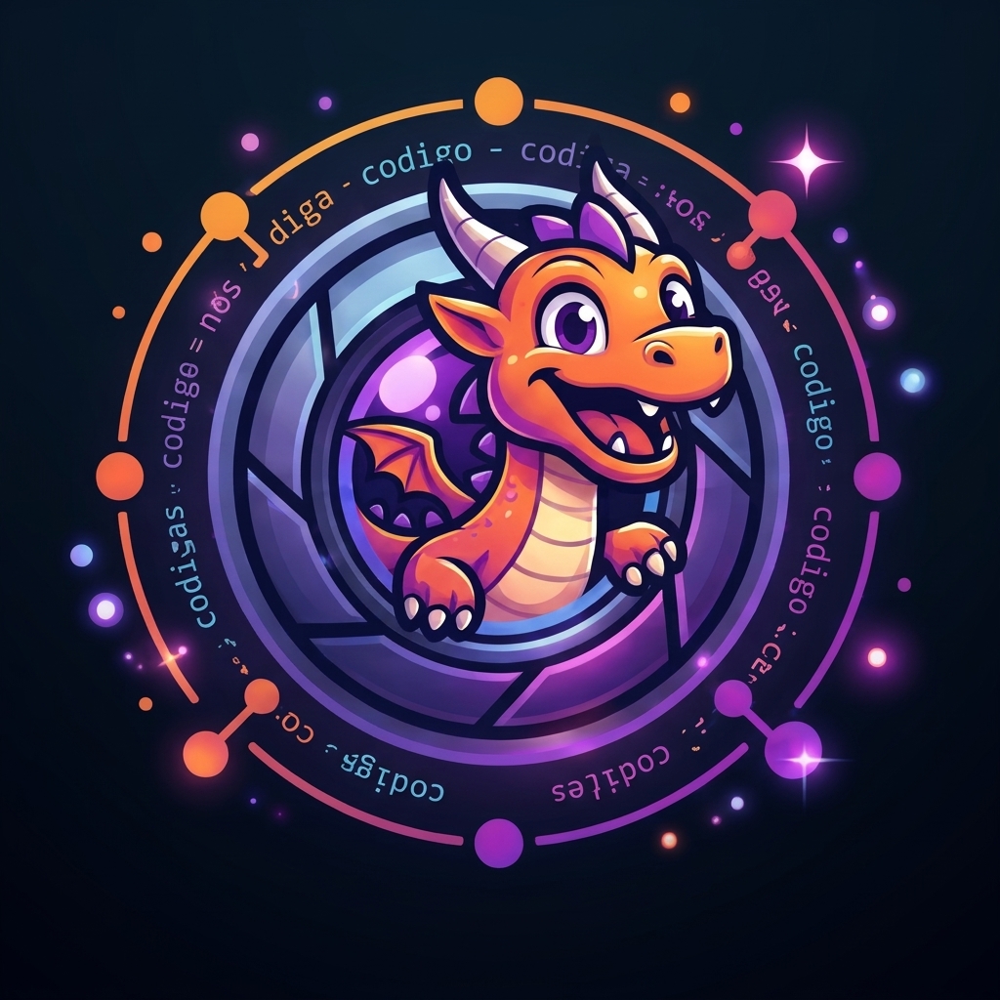

<p align="center"></p>

# avat-os

Estudio de VTuber **open source** para Windows: tu avatar 3D y la producción de video en una sola aplicación.

- **Avatar:** carga avatares VRM, seguimiento facial por webcam, lip-sync, expresiones con atajos, fondos y efectos.
- **Producción:** escenas y fuentes (cámara, pantalla, ventana, imagen, texto), chroma key, mezclador de audio y grabación MP4.

> Estado: en desarrollo temprano (Fase 0). El plan completo está en [tareas.md](tareas.md).

## Tecnología

- [Rust](https://www.rust-lang.org/) + [Tauri 2](https://tauri.app/) (aplicación de escritorio)
- [SvelteKit](https://svelte.dev/) + TypeScript (interfaz)
- [libobs](https://github.com/obsproject/obs-studio) (composición, audio y grabación)
- [VRM](https://vrm.dev/) (formato de avatar 3D)

## Documentación

- 📘 [Guía de usuario](docs/GUIA-DE-USUARIO.md): cómo usar avat-os, qué avatares e imágenes sirven y cómo ajustar ojos, boca y cuerpo.
- 🛠️ [Guía del programador](docs/GUIA-DEL-PROGRAMADOR.md): stack, arquitectura, módulos, protocolos internos y cómo contribuir.
- 🗺️ [Plan de trabajo](tareas.md): fases y avance.

## Desarrollo

Requisitos: Rust, Node.js 20+, Visual Studio Build Tools (C++) y WebView2.

```sh
npm install
npm run tauri dev
```

## Licencia

avat-os es software libre bajo la licencia **GNU GPL v3 o posterior** (`GPL-3.0-or-later`). Consulta [LICENSE](LICENSE).
