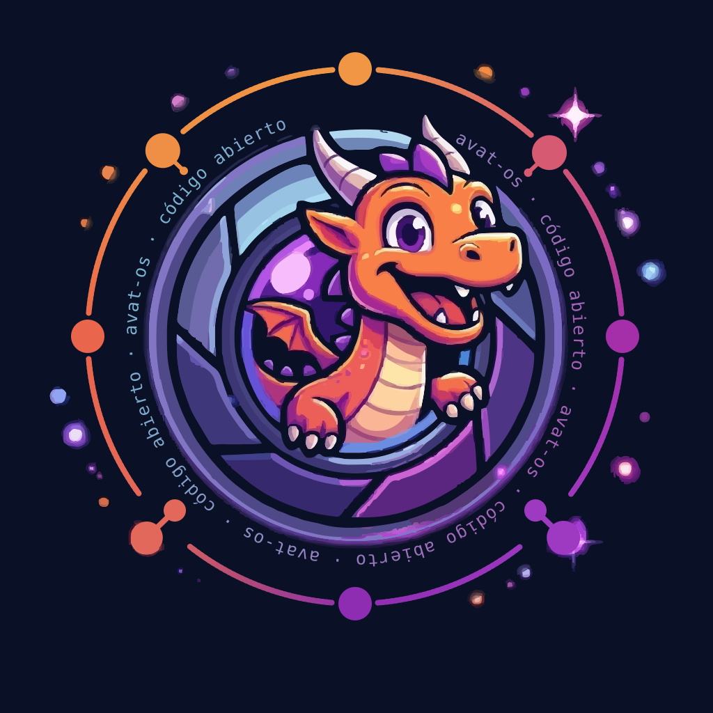

<p align="center"></p>

# Guía de usuario de avat-os

> **Versión del programa:** 0.1.0 (en desarrollo, Fase 1). Esta guía se actualiza junto con cada cambio del programa.
> Si algo de lo que lees aquí no coincide con lo que ves en pantalla, avísanos abriendo un *issue* en GitHub.

avat-os es un estudio para VTubers: en un solo programa tienes **tu avatar 3D que copia tu cara** y la **producción del video** (escenas, audio y grabación), sin tener que juntar varios programas.

---

## Contenido

1. [Requisitos](#1-requisitos)
2. [Primeros pasos](#2-primeros-pasos)
3. [La ventana de avat-os](#3-la-ventana-de-avat-os)
4. [Avatares](#4-avatares)
5. [Seguimiento facial (tracking)](#5-seguimiento-facial-tracking)
6. [Lip-sync: la boca con tu voz](#6-lip-sync-la-boca-con-tu-voz)
7. [Expresiones, gestos y atajos de teclado](#7-expresiones-gestos-y-atajos-de-teclado)
8. [Calibración y ajustes de ojos, boca y cuerpo](#8-calibración-y-ajustes-de-ojos-boca-y-cuerpo)
9. [Fondo, efectos y objetos en pantalla](#9-fondo-efectos-y-objetos-en-pantalla)
10. [Privacidad](#10-privacidad)
11. [Solución de problemas](#11-solución-de-problemas)
12. [Qué viene después](#12-qué-viene-después)

---

## 1. Requisitos

| | Mínimo | Recomendado |
|---|---|---|
| Sistema | Windows 10/11 de 64 bits | Windows 11 |
| Gráficos | GPU integrada (Intel Iris Xe o similar) | GPU dedicada (NVIDIA / AMD) |
| Memoria | 8 GB de RAM | 16 GB de RAM |
| Cámara | Cualquier webcam (para el tracking facial) | Webcam 720p o superior, buena luz de frente |

En un portátil con Intel Iris Xe, avat-os usa aproximadamente **8 % de CPU** y el tracking facial funciona a **45–56 FPS**.

> Por ahora avat-os todavía no tiene instalador: se ejecuta en modo desarrollo. Los pasos están en la
> [Guía del programador](GUIA-DEL-PROGRAMADOR.md#3-preparar-el-entorno). El instalador llegará en la Fase 6.

---

## 2. Primeros pasos

1. Abre avat-os.
2. En el panel **AVATAR** (a la derecha), pulsa **Cargar avatar .vrm** y elige un avatar. Junto a su nombre verás **cargando…** y luego **listo** cuando aparezca en la vista previa.
   El selector se abre directamente en la carpeta de avatares de prueba ([sección 4](#4-avatares)).
3. Pulsa el botón **Tracking facial** (dice *apagado*). Se encenderá la luz de tu cámara.
4. Mira a la cámara: en el panel aparecerá **Cara detectada** y tu avatar empezará a copiar tu cabeza, ojos y boca.

**Ayuda en pantalla:** deja el mouse quieto un momento sobre un botón u opción (o llega a él con la tecla `Tab`) y aparece una explicación breve. Los íconos **ⓘ** también muestran ayuda; en las partes que todavía no funcionan, te avisan de que están en construcción. `Esc` cierra la ayuda.

**Idioma:** la primera vez, avat-os se abre en el idioma de tu Windows (español o inglés; si tu Windows está en otro idioma, en inglés). Puedes cambiarlo cuando quieras con el selector de la esquina superior derecha; el cambio es inmediato y se recuerda para la próxima vez.

Solo puede haber **una copia de avat-os abierta**: si la abres otra vez, se trae al frente la que ya estaba abierta.

Para cerrar, usa la **X** de la ventana. La ventana desaparece al instante y el programa termina de apagarse en segundo plano en unos segundos.

---

## 3. La ventana de avat-os

```
┌──────────────────────────────────────────────────────────┬──────────────┐
│  avat-os                                          v0.1.0 │              │
├──────────────────────────────────────────────────────────┤   AVATAR     │
│                                                          │  [Cargar]    │
│                    VISTA PREVIA                          │  Avatar      │
│           (lo que se va a grabar, 1920×1080)             │  Tracking    │
│                                                          │  Lip-sync    │
│                                                          │  Fondo       │
├──────────────┬──────────────┬────────────────────────────┼──────────────┤
│  ESCENAS     │  FUENTES     │  MEZCLADOR DE AUDIO        │  CONTROLES   │
└──────────────┴──────────────┴────────────────────────────┴──────────────┘
```

| Zona | Para qué sirve | Estado |
|---|---|---|
| **Selector de idioma** (arriba a la derecha) | Cambiar la interfaz entre **Español** e **English** | ✅ Funciona |
| **Vista previa** | Muestra la escena tal como se grabará | ✅ Funciona |
| **Avatar** | Cargar el avatar, encender el tracking facial y el lip-sync, calibrar, elegir la expresión, el fondo y los efectos | ✅ Funciona |
| **Escenas / Fuentes** | Organizar lo que aparece en pantalla | 🚧 Solo visual (Fase 2) |
| **Mezclador de audio** | Volumen del micrófono y del escritorio | 🚧 Solo visual (Fase 3) |
| **Controles** | Iniciar/detener la grabación | 🚧 Solo visual (Fase 4) |

---

## 4. Avatares

### Qué archivos sirven

avat-os usa avatares 3D en formato **VRM** (archivos `.vrm`), el estándar abierto para avatares de VTuber.

| Formato | ¿Funciona? |
|---|---|
| `.vrm` versión **1.0** | ✅ Sí |
| `.vrm` versión **0.x** (la más común en modelos antiguos) | ✅ Sí |
| `.fbx`, `.pmx` (MMD), `.glb` sin VRM | ❌ No. Hay que convertirlos a VRM primero (por ejemplo con Unity + UniVRM o Blender + VRM Add-on) |
| Avatares 2D (Live2D, PNG) | ❌ Todavía no (planeado después de la v1.0) |

### Dónde poner tus avatares

Copia tus avatares en la carpeta:

```
avat-os\recursos\avatares\
```

El botón **Cargar avatar .vrm** se abre en esa carpeta. También puedes elegir un `.vrm` desde cualquier otra carpeta de tu equipo.

**Avatares recientes:** avat-os recuerda los últimos 8 avatares que cargaste.

- Al abrir avat-os, **el último se carga solo**.
- Para volver a otro, abre **Avatares recientes** en el panel AVATAR y pulsa su nombre. El que está cargado dice *en uso*.
- Si moviste o borraste un archivo, aparece tachado (*no se encuentra*). **Quitar** lo saca de la lista; el archivo no se toca.

> 🔒 **Tus archivos son privados.** Nada de lo que copies en `recursos\` se sube a GitHub: el proyecto está configurado para ignorar esos archivos.

### Avatares de prueba incluidos

| Archivo | Autor | Licencia |
|---|---|---|
| `Seed-san.vrm` | VirtualCast, Inc. | Libre, incluso comercial. **Pide crédito** si lo muestras: "Seed-san por VirtualCast, Inc." |
| `VRM1_Constraint_Twist_Sample.vrm` | pixiv Inc. | Libre, incluso comercial. No pide crédito |

Los detalles están en `recursos\avatares\CREDITOS.txt`.

### Conseguir más avatares

- **Crear el tuyo gratis:** [VRoid Studio](https://vroid.com/studio) → *Exportar → Exportar como VRM*.
- **Descargar:** [VRoid Hub](https://hub.vroid.com/).

> ⚠️ **Respeta la licencia de cada avatar.** Dentro de cada `.vrm` el autor indica si permite usarlo en streams, con fines comerciales o modificarlo. Algunos modelos lo prohíben.

### Qué necesita tener el avatar para funcionar bien

avat-os usa las **expresiones estándar de VRM**. Casi todos los avatares hechos con VRoid las traen:

| Expresión VRM | Para qué la usa avat-os |
|---|---|
| *LookAt* (mirada) del VRM | Mover los ojos hacia donde miras |
| `blinkLeft` / `blinkRight` | Cerrar cada ojo según tu cara |
| `blink` | Parpadeo automático cuando el tracking está apagado |
| Huesos de brazos, hombros y cabeza | Gestos animados ([sección 7](#7-expresiones-gestos-y-atajos-de-teclado)) |
| `happy`, `angry`, `sad`, `surprised`, `relaxed` | Expresiones de los atajos de teclado ([sección 7](#7-expresiones-gestos-y-atajos-de-teclado)) |
| `aa` | Abrir la boca |
| `ou` | Boca en forma de "o" |
| Huesos `spine`, `chest`, `neck`, `head` | Mover el cuerpo y la cabeza |

Si a tu avatar le falta alguna, esa parte simplemente no se moverá.

---

## 5. Seguimiento facial (tracking)

### Cómo usarlo

1. Pulsa **Tracking facial** → cambia a *encendido*.
2. La primera vez puede aparecer un aviso pidiendo permiso para usar la cámara: acéptalo.
3. Para apagarlo, pulsa de nuevo el botón (la cámara se apaga).

### Qué copia el avatar

| Tu movimiento | Lo que hace el avatar |
|---|---|
| Girar, inclinar o asentir con la cabeza | Gira la cabeza; el cuello, el pecho y la columna acompañan el giro |
| Inclinarte hacia un lado | Inclina el torso |
| Acercarte o alejarte de la cámara | Se acerca o se aleja de su cámara en la misma proporción (se ve más grande o más chico) y se inclina un poco; su cara queda en el mismo lugar de la pantalla. Hasta un 30 % más cerca y un 50 % más lejos. Sin calibrar, a los pocos segundos toma la nueva distancia como la normal; con calibración, la distancia normal es la del paso 1 |
| Parpadear o guiñar un ojo | Cierra el ojo correspondiente (como un espejo) |
| Mirar hacia un lado, arriba o abajo | Mueve los ojos hacia el mismo lado (cada avatar decide cuánto pueden girar sus ojos) |
| Abrir la boca / hablar | Abre la boca |
| Poner la boca en "o" | Boca redonda |
| Dejar de estar frente a la cámara | Después de medio segundo vuelve a la animación de reposo (respiración y parpadeo automático) |

El avatar **siempre respira**, también con el tracking encendido. La sonrisa **no** activa la cara de "alegre": las emociones se activan con los atajos de teclado ([sección 7](#7-expresiones-gestos-y-atajos-de-teclado)).

### Lo que muestra el panel

| Texto | Significado |
|---|---|
| **Cara detectada** / **Buscando cara…** | Si la cámara te está viendo |
| **46 FPS** | Cuántas veces por segundo se analiza tu cara. Más de 25 es suficiente |
| **Boca 0.12** | Cuánto abres la boca según la cámara (0 = cerrada, 1 = muy abierta) |
| **Ojo izq. 0.05 · der. 0.04** | Cuánto cierras cada ojo según la cámara (0 = abierto, 1 = cerrado) |

Estos tres números te sirven para afinar los ajustes de la [sección 8](#8-calibración-y-ajustes-de-ojos-boca-y-cuerpo).

### Consejos para que funcione mejor

- **Luz de frente**, no detrás de ti (una ventana a tu espalda oscurece la cara).
- La cámara a la **altura de los ojos**, a 40–80 cm.
- Si usas lentes con reflejos, el parpadeo puede detectarse peor.
- El tracking sigue funcionando aunque pongas otra ventana encima de avat-os (por ejemplo, un juego).

---

## 6. Lip-sync: la boca con tu voz

El lip-sync mueve la boca del avatar **con tu voz**, usando el micrófono. Funciona **con o sin cámara**: puedes usarlo solo, o junto al tracking facial para que la boca se mueva aunque la cámara no te vea bien.

1. En el panel **AVATAR**, pulsa el botón de **Lip-sync** (dice *apagado*). La primera vez, Windows puede pedir permiso para el micrófono.
2. Aparece la barra **Voz** y, debajo, el desplegable **Ajustes del lip-sync** con estas opciones:

| Opción | Para qué sirve |
|---|---|
| **Voz** | Barra con lo que mide el micrófono en este momento. En silencio debe quedarse casi en 0. Al lado aparece la **vocal** que se reconoce (A, E, I, O, U) |
| **Micrófono** | Elige el micrófono con el que hablas (por defecto, el predeterminado de Windows) |
| **Boca** | **Cámara + voz** (recomendado): la boca usa lo mayor entre la cámara y la voz, así se mueve al hablar aunque la cámara no te vea bien y también cuando ríes sin hacer ruido. **Solo voz**: ignora la boca de la cámara |
| **Forma** | **Vocales (A E I O U)** (recomendado): la boca toma la forma de la vocal que dices, reconocida por el sonido de tu voz. **Solo abrir y cerrar**: la boca se abre según el volumen, siempre con la forma de la A |
| **Vocales** | Dice si se usan los **valores típicos** o los **calibrados para tu voz**. **Calibrar** enseña a avat-os cómo suenan tus vocales (ver abajo) |
| **Sensibilidad** | **Más**: la boca se abre con la voz más baja. **Menos**: hace falta hablar más fuerte |

- Tus elecciones (micrófono, modo, forma y sensibilidad) **se recuerdan** para la próxima vez.
- Sin calibrar, las vocales se **ajustan a tu voz** (grave o aguda) en el primer segundo que hablas. En las consonantes (por ejemplo la **m** o la **s**) la boca mantiene la forma de la vocal anterior. Si tu avatar no trae alguna vocal, usa la A en su lugar.
- **Privacidad:** el audio se analiza en tu equipo; al avatar solo llegan números (cuánto abrir la boca y qué vocal es). Nada se graba ni se envía a internet.

| Si… | Haz esto |
|---|---|
| La boca se mueve sola con el ruido de fondo o al teclear | Baja la **Sensibilidad** |
| La boca casi no se mueve al hablar | Sube la **Sensibilidad** o acércate al micrófono |
| La barra **Voz** no se mueve | Revisa que el **Micrófono** elegido sea el correcto |
| Confunde vocales (por ejemplo, la E sale como I) | **Calibra las vocales** (abajo) |
| La vocal salta mucho | Acércate al micrófono y baja el ruido de fondo (el ruido confunde las vocales). Si no mejora, usa **Forma → Solo abrir y cerrar** |

### Calibrar las vocales

Cada voz pronuncia las vocales un poco distinto, y cada micrófono las capta distinto. Si el lip-sync confunde alguna, enséñale cómo suenan en tu voz y con tu micrófono (unos 15 segundos). Con la calibración, avat-os compara la forma completa del sonido de cada vocal, y acierta mucho más:

1. Con el lip-sync encendido y **Forma → Vocales**, pulsa **Calibrar** en la fila **Vocales**.
2. Aparece una letra grande. Cuando el recuadro se pone naranja, **di esa vocal y sostenla** (por ejemplo "aaaaa") hasta que se llene la barra. Se piden en orden: A, E, I, O, U.
3. Al final verás tus valores. Pulsa **Guardar**.

- Si dos vocales salieron muy parecidas, aparece un aviso: repite la calibración pronunciándolas bien distintas.
- Si no se oye bien una vocal, acércate al micrófono y pulsa **Reintentar**.
- **Restablecer** vuelve a los valores típicos. La calibración se guarda en este equipo; **recalibra si cambias de micrófono o si cambia mucho el ruido del lugar**.
- Si actualizaste avat-os y dice *valores típicos* aunque habías calibrado, vuelve a calibrar: la forma de medir mejoró y la calibración vieja ya no sirve.
- Durante la calibración se ven en vivo algunas medidas de tu voz (F1, F2 y tono) y al final una tabla: son solo de referencia (a veces muestran "—"); la calibración usa la forma completa del sonido.

---

## 7. Expresiones, gestos y atajos de teclado

Tu avatar puede poner cara de alegre, enojado, triste, sorpresa o relajado. Se activan de dos formas:

- **Con los botones** del panel AVATAR: abre la sección desplegable **Expresiones y gestos** (si hay una expresión activa, se ve su nombre al lado del título). Los desplegables del panel recuerdan si los dejaste abiertos o cerrados.
- **Con atajos de teclado**, que funcionan **aunque avat-os no esté en primer plano** (por ejemplo, mientras juegas).

| Atajo | Expresión |
|---|---|
| `Ctrl` + `Shift` + `1` | 😄 Alegre |
| `Ctrl` + `Shift` + `2` | 😠 Enojado |
| `Ctrl` + `Shift` + `3` | 😢 Triste |
| `Ctrl` + `Shift` + `4` | 😲 Sorpresa |
| `Ctrl` + `Shift` + `5` | 😌 Relajado |

- **Para volver a la cara normal**, pulsa otra vez el atajo de la expresión activa, o el botón **😐 Neutral**.
- El cambio no es brusco: la cara pasa de una expresión a otra en unos 0,2 segundos.
- El tracking sigue funcionando con una expresión activa: tu cabeza, tus ojos y tu boca siguen moviendo al avatar.
- La expresión elegida se mantiene si cargas otro avatar.

> **¿Por qué a veces no parpadea o no mueve la boca con una expresión activa?** Lo decide el autor del avatar.
> El formato VRM permite que cada expresión **bloquee el parpadeo o la boca** mientras está puesta, porque esa
> expresión ya trae su propia forma de ojos o de boca (la sonrisa de "alegre", la "O" de "sorpresa") y mezclarlas
> podría deformar la cara. avat-os **respeta siempre la configuración del autor**. Por ejemplo:
>
> | Avatar | Expresiones que bloquean la boca |
> |---|---|
> | `VRM1_Constraint_Twist_Sample` (pixiv) | Alegre, Sorpresa, Triste |
> | `Seed-san` | Ninguna (la boca se mueve con todas) |

### Gestos animados

Además de las expresiones, el avatar puede hacer **gestos**: animaciones cortas que **terminan solas**. Se activan con los botones de **Gestos** del panel o con atajos (también aunque avat-os no esté en primer plano):

| Atajo | Gesto |
|---|---|
| `Ctrl` + `Shift` + `6` | 👋 Saludar |
| `Ctrl` + `Shift` + `7` | 🙂 Asentir |
| `Ctrl` + `Shift` + `8` | 🙅 Negar con la cabeza |
| `Ctrl` + `Shift` + `9` | 🤷 Encogerse de hombros ("no sé") |

- Se combinan con el tracking: puedes saludar mientras la cámara sigue tu cabeza.
- Funcionan con cualquier avatar VRM (usan sus huesos estándar).

### Elegir tus propios atajos

En el panel **AVATAR**, abre **Atajos de teclado** (debajo de los gestos). Ahí está cada acción con su atajo:

- **Expresiones** y **Gestos**: vienen con los atajos de las tablas de arriba.
- **Avatar**: **Encender/apagar tracking** y **Encender/apagar lip-sync**. Vienen **sin atajo**: un atajo global le quita esa combinación a todos los programas (por ejemplo, Ctrl+Shift+T dejaría de reabrir pestañas en tu navegador), así que lo eliges tú.

Para cambiar un atajo: pulsa **Cambiar**, presiona la combinación nueva y listo (**Esc** cancela). **Quitar** deja la acción sin atajo y **Restablecer atajos** vuelve a los de fábrica. Se guardan solos.

Reglas para que un atajo no estorbe (si no se cumplen, el editor te explica por qué):

| Regla | Motivo |
|---|---|
| Debe llevar **Ctrl** o **Alt** (o ser una tecla **F1–F24**) | Una letra sola dejaría de escribirse en todos los programas |
| No puede usar **Ctrl+Alt** | En teclados en español es **AltGr** (la tecla para escribir @, #…) |
| No puede usar la tecla **Windows** ni combinaciones del sistema (Alt+Tab, Alt+F4, Ctrl+Shift+Esc…) | Son de Windows |
| No puede ser **Ctrl+Shift+0** | Windows la usa para cambiar el idioma del teclado |
| Puede usar los símbolos de **tu** teclado (ñ, +, ´, ç…), pero no la tecla **<** (a la izquierda de la Z) | Esa tecla no se puede registrar como atajo global; el editor te avisa |
| No puede repetirse | Dos acciones no pueden tener el mismo atajo |
| No puede usarla otro programa | Windows solo deja un dueño por atajo |

Algunas combinaciones Windows se las queda **antes** de que lleguen a avat-os (por ejemplo
**Ctrl+Shift+0**, si en tu equipo es el atajo para cambiar el idioma del teclado). En ese caso
la tecla nunca llega al editor: al soltar Ctrl, Shift… el editor avisa _"no llegó ninguna
tecla"_. Elige otra combinación.

---

## 8. Calibración y ajustes de ojos, boca y cuerpo

### Calibrar (recomendado)

La calibración adapta el tracking **a tu cara y a tu cámara**: cuánto cierras los ojos al parpadear, cuánto abres la boca al hablar, cuál es tu postura "de frente" y hacia dónde miras cuando miras la pantalla (como la cámara suele estar más arriba, sin calibrar el avatar podría parecer que mira un poco hacia abajo). Si tu cámara está a un costado o más alta que la pantalla, después de calibrar el avatar mirará al frente cuando tú mires a la pantalla.

1. Siéntate como cuando transmites, con buena luz de frente.
2. En el panel **AVATAR**, junto a **Calibración**, pulsa **Calibrar** (si el tracking está apagado, se enciende solo).
3. Arriba a la derecha del asistente verás **● te veo** (en verde) si la cámara te detecta; si dice **● no te veo**, mejora la luz o ponte de frente. **Empezar** solo se activa cuando te ve.
4. Pulsa **Empezar** y sigue los 3 pasos. **Cada paso espera a que pulses su botón Empezar**, así tienes tiempo de leer la instrucción. Después hay una cuenta atrás de 3 segundos y se mide durante unos 2 segundos (no te preocupes si reaccionas un poco tarde: el primer momento no se cuenta):
   1. Mira la pantalla de frente, con los ojos abiertos y la boca cerrada.
   2. **Al oír el primer pitido, cierra los ojos** y mantenlos cerrados **hasta el segundo pitido** (no podrás leer la pantalla, por eso los pitidos).
   3. Abre la boca lo más que puedas. Una barra te muestra lo que mide la cámara.
5. Llegas a **Prueba y ajuste**: el avatar **ya usa** tu calibración, aunque todavía no esté guardada. Parpadea y habla para comprobarlo.
   - Las barras **Ojo izq.**, **Ojo der.** y **Boca** muestran lo que mide la cámara en este momento. Cada ojo tiene sus propias marcas: la cámara suele ver un ojo más cerrado que el otro (por la luz o si está a un costado), y así los dos parpadean parejo. La marca gris es donde el avatar empieza a cerrar los ojos (o a abrir la boca) y la blanca, donde lo hace del todo; la barra se pone **naranja** al pasarla.
   - Si no te convence, mueve **Sensibilidad de los ojos** o **Sensibilidad de la boca** hacia *más* o *menos*: el avatar cambia al instante.
6. Pulsa **Guardar**. **Repetir** vuelve a hacer los 3 pasos y **Cancelar** descarta los cambios (el avatar vuelve a lo que tenías).

| Si… | Mueve… |
|---|---|
| El avatar no cierra del todo los ojos al parpadear | Sensibilidad de los ojos → **más** |
| Dice *no se notó la diferencia entre ojos abiertos y cerrados* | El mensaje muestra lo que midió de cada ojo. Para la cámara, tus ojos cambian poco al cerrarse: pon más luz de frente, quítate los lentes si los usas, mantén los ojos bien cerrados entre los pitidos y repite. Si sigue fallando, anota los números del mensaje |
| Aparece *tus ojos dan una señal pequeña* | La calibración se puede guardar; si el avatar no parpadea bien, prueba con más luz de frente o sin lentes y recalibra |
| El avatar entrecierra los ojos cuando los tienes abiertos | Sensibilidad de los ojos → **menos** |
| El avatar hace parpadeos cortos que tú no hiciste | **Recalibra y pulsa Guardar** (se miden los dos ojos por separado); si sigue, sensibilidad de los ojos → **menos** |
| Un guiño tarda un poco en verse | Es a propósito: cerrar un solo ojo tiene que durar un instante (~0,1 s) para que el ruido de la cámara no parezca un guiño. Los parpadeos con los dos ojos se ven al instante |
| Al hablar, la boca del avatar casi no se mueve | Sensibilidad de la boca → **más** |
| La boca se abre de forma exagerada | Sensibilidad de la boca → **menos** |

- La calibración **se guarda** y se aplica sola cada vez que abres avat-os. El panel muestra *calibrado*.
- Para retocar la sensibilidad más tarde **sin repetir los pasos**, pulsa **Ajustar**.
- Para volver a los valores de fábrica, pulsa **Restablecer**.
- Si cambias de cámara, de lugar o de lentes, vuelve a calibrar (**Recalibrar**).

| Mensaje | Qué hacer |
|---|---|
| "No se vio tu cara durante la calibración" | Mejora la luz, ponte de frente a la cámara y repite |
| "No se notó la diferencia entre ojos abiertos y cerrados" | Repite y mantén los ojos bien cerrados entre los dos pitidos |
| "No se notó la boca abierta" | Repite y abre la boca lo más que puedas |

### Ajustes avanzados (editando un archivo)

> Solo para usuarios avanzados. **Con una calibración guardada, los valores de ojos y boca de esta sección no se usan**
> (se usan los tuyos); siguen aplicándose los de cuerpo y suavizado. Pronto habrá deslizadores en la interfaz.

### Dónde se cambian

Todos están en el archivo **`avatar\main.ts`** (ábrelo con el Bloc de notas o VS Code). Busca el nombre del ajuste y cambia solo el número.

### Ojos

| Ajuste | Valor actual | Qué hace | Cuándo cambiarlo |
|---|---|---|---|
| `EYE_OPEN` | `0.2` | Por **debajo** de este valor el ojo del avatar queda **abierto** | Si el avatar entrecierra los ojos cuando tú los tienes abiertos → **súbelo** (por ejemplo a `0.3`) |
| `EYE_CLOSED` | `0.55` | Desde este valor el ojo del avatar queda **cerrado del todo** | Si al parpadear el avatar no cierra del todo → **bájalo** (por ejemplo a `0.45`) |

**Cómo elegir los números:** enciende el tracking y mira **Ojo izq./der.** en el panel.
- Con los ojos abiertos: pon `EYE_OPEN` un poco **por encima** de lo que marca.
- Con los ojos cerrados: pon `EYE_CLOSED` un poco **por debajo** de lo que marca.

### Boca

| Ajuste | Valor actual | Qué hace | Cuándo cambiarlo |
|---|---|---|---|
| `MOUTH_CLOSED` | `0.03` | Por debajo de este valor la boca queda **cerrada** | Si la boca tiembla con la boca cerrada → **súbelo** (por ejemplo a `0.06`) |
| `MOUTH_OPEN` | `0.35` | Desde este valor la boca queda **abierta del todo** | Si al hablar la boca se mueve poco → **bájalo** (por ejemplo a `0.25`) |

**Cómo elegir los números:** mira **Boca** en el panel mientras hablas normalmente y pon `MOUTH_OPEN` cerca del valor más alto que veas.

### Cuerpo y suavizado

El **anti-temblor** de la cabeza, la posición y la mirada está en `avatar/smoothing.ts` (filtro *One Euro*: con la cabeza quieta suaviza mucho y al moverte casi nada, así no tiembla ni se queda atrás). Los demás ajustes están dentro de la función `applyTracking` de `avatar/main.ts`:

| Ajuste (cómo aparece en el código) | Valor actual | Qué hace |
|---|---|---|
| `HEAD_FILTER` (en `smoothing.ts`) | `minCutoff: 0.5, beta: 2` | Anti-temblor de la cabeza. **`minCutoff` más bajo** = menos temblor quieto; **`beta` más alto** = menos retraso al girar rápido |
| `HEAD_DEADBAND` (en `smoothing.ts`) | `0.0087` (0,5°) | Movimientos de la cabeza más chicos que esto se ignoran (quita tirones con la cabeza quieta). **Más alto** = más quieto, pero los movimientos muy pequeños no se ven |
| `FRAME_INTERPOLATION` (en `smoothing.ts`) | `45` | Une las muestras del tracking (30 por segundo) entre cuadros; no conviene bajarlo |
| `delta * 45` | `45` | Velocidad de ojos y boca (tienen que ser rápidos: un parpadeo dura ~150 ms) |
| `* 0.012` y `0.25` | `0.012` / `0.25` | Cuánto se inclina el torso hacia los lados al moverte, y el máximo permitido |
| `* 0.01` y `0.2` | `0.01` / `0.2` | Cuánto se inclina el torso hacia adelante al acercarte, y el máximo |
| `APPROACH_MAX_IN` / `APPROACH_MAX_OUT` | `0.3` / `0.5` | Cuánto puede acercarse (30 %) y alejarse (50 %) el avatar de su cámara cuando tú te acercas o te alejas de la tuya |
| `["spine", 0.15], ["chest", 0.15], ["neck", 0.3], ["head", 0.4]` | 15 % · 15 % · 30 % · 40 % | Cómo se reparte el giro de la cabeza entre columna, pecho, cuello y cabeza (deben sumar 1) |
| `delta / 8` | `8` segundos | Cada cuánto el programa vuelve a tomar tu postura como "normal" |

### Aplicar los cambios

1. Guarda el archivo.
2. Cierra avat-os y vuelve a abrirlo (al arrancar se recompila la página del avatar).

Si algo deja de funcionar, vuelve a poner los valores de la columna **Valor actual**.

---

## 9. Fondo, efectos y objetos en pantalla

### Fondo del avatar

En el panel **AVATAR**, la opción **Fondo** elige qué se ve detrás del avatar:

| Fondo | Qué hace |
|---|---|
| **Transparente** (por defecto) | Se ve lo que haya debajo en la escena: tu pantalla, un juego… |
| **Color** | Un color sólido; aparece una paleta para elegirlo. El verde que viene por defecto sirve para recortar el avatar con *chroma key* en otro programa |
| **Imagen o video** | Una imagen o un video detrás del avatar. Al elegir esta opción se abre el selector en la carpeta `recursos\fondos` |

Con **Imagen o video** aparecen dos opciones más:
- **Cambiar…**: elige otro archivo.
- **Ajuste**: **Cubrir** (la imagen llena todo; si su proporción no es 16:9, se recortan los bordes) o **Ajustar** (se ve entera; pueden quedar bandas transparentes a los lados). Si la imagen o el video ya es 16:9 (como 1920×1080), las dos opciones se ven **igual**: no hay nada que recortar ni bandas. Para ver la diferencia, prueba `recursos\fondos\fondo-cuadrado.png` o `fondo-cuadrado.mp4`.

**Formatos de imagen:** PNG, JPG, WebP o GIF. Los **GIF y WebP animados se ven animados**. Tamaño ideal: **1920×1080**.

**Formatos de video:** **MP4** (H.264) o **WebM** (VP8/VP9). El video se repite en bucle y **sin sonido** (el sonido llegará con el mezclador de audio). Si un video no se puede reproducir, el panel lo avisa debajo de **Fondo**.

El fondo **se recuerda** al cerrar avat-os. Si mueves o borras la imagen, la próxima vez el fondo vuelve a transparente.

> 💡 Para objetos (stickers, marcos), usa siempre PNG con transparencia: si guardas un sticker en JPG, se verá con un recuadro de fondo.

### Efectos: cámara, luz y contorno

En el panel **AVATAR**, abre **Efectos** (está plegado para no alargar el panel). Los cambios se ven **al instante** en la vista previa y **se guardan solos**.

| Grupo | Opción | Qué hace |
|---|---|---|
| **Cámara** | **Plano** | **Primer plano** (cabeza y hombros), **Plano medio** (de la cintura para arriba, el típico de VTuber) o **Cuerpo entero**. Se adapta a la altura de cada avatar y cambia con una transición suave |
| | **Zoom** | Acerca o aleja la cámara |
| | **Altura** | Sube o baja el encuadre |
| | **Ángulo** | Gira la cámara alrededor del avatar (para verlo de costado) |
| **Luz** | **Intensidad** | Fuerza de la luz principal (en el medio = normal) |
| | **Color** | Color de la luz: blanca, cálida, de neón… |
| | **Dirección** | Desde dónde llega la luz: izquierda, frente o derecha |
| | **Ambiente** | Luz suave que rellena las sombras (más = menos sombras) |
| | **Contorno** | Grosor del contorno de dibujo animado: a la izquierda del todo lo quita. **Solo funciona si el avatar trae contorno** (la mayoría de los hechos con VRoid lo traen) |

**Restablecer efectos** vuelve a la cámara, la luz y el contorno por defecto.

### Objetos en pantalla

> 🚧 **Todavía no se pueden mostrar en el programa** (llegan en la Fase 2, con la fuente "Imagen" de las escenas), pero ya puedes ir preparando tus imágenes.

| Carpeta | Qué va | Formatos | Tamaño recomendado |
|---|---|---|---|
| `recursos\fondos\` | Fondos de escena o detrás del avatar | `.png`, `.jpg`, `.webp`, `.gif` (animado) | **1920×1080** |
| `recursos\objetos\` | Stickers, marcos, logos, alertas | **`.png` o `.webp` con fondo transparente**, `.gif` | Libre (un marco de pantalla completa: 1920×1080) |

**Imágenes de prueba incluidas** (libres de uso): `fondo-galaxia.png`, `marco-neon.png`, `sticker-estrella.png` y `logo-avat-os.png`.

---

## 10. Privacidad

- **La cámara y el micrófono nunca salen de tu equipo.** El lip-sync solo envía al avatar números (cuánto abrir la boca y qué vocal es).
- **La cámara nunca sale de tu equipo.** El análisis de tu cara se hace en tu computadora; no se envía nada a internet.
- **Funciona sin internet.** El modelo de detección facial se descarga una sola vez al preparar el programa.
- Los servidores internos de avat-os solo aceptan conexiones de tu propia computadora (`127.0.0.1`).
- Tus avatares e imágenes en `recursos\` nunca se suben al repositorio público.

---

## 11. Solución de problemas

| Problema | Qué hacer |
|---|---|
| **La vista previa dice "Vista previa no disponible"** | El motor de video (OBS) no arrancó. Cierra avat-os y vuelve a abrirlo; si sigue igual, revisa el mensaje en la terminal ("No se pudo iniciar libobs") |
| **El botón Cargar avatar está gris** | Es lo mismo: el motor de video no arrancó |
| **"Elige un archivo .vrm válido"** | El archivo no es `.vrm` o no existe. Convierte el modelo a VRM ([sección 4](#4-avatares)) |
| **El avatar no aparece después de cargarlo** | Mira el estado junto al nombre del avatar en el panel: **cargando…** = espera (la primera vez, o con el equipo muy ocupado, por ejemplo justo después de compilar, puede tardar hasta un minuto); **listo** = ya está en la escena; si aparece un **mensaje en rojo**, el archivo está dañado o no es un VRM real: prueba con un avatar de prueba incluido |
| **"No se pudo iniciar la cámara"** | Cierra otros programas que usen la cámara (Zoom, Teams, la app Cámara) y revisa *Configuración de Windows → Privacidad → Cámara* |
| **"Elige una imagen (PNG, JPG, WebP o GIF) o un video (MP4 o WebM) que exista"** | El archivo no es de esos formatos o ya no está en su carpeta |
| **"Este video no se puede reproducir…"** | Su formato interno (códec) no es compatible, aunque termine en .mp4 o .webm. Conviértelo a MP4 H.264 o WebM VP9 (por ejemplo con HandBrake, gratuito) |
| **"No hay permiso para usar el micrófono"** | Revisa *Configuración de Windows → Privacidad → Micrófono* y permite el acceso a las aplicaciones de escritorio |
| **"El micrófono está en uso por otro programa"** | Algún programa lo usa en modo exclusivo (por ejemplo, un software de audio): ciérralo o desactiva el modo exclusivo en la configuración de sonido |
| **Buscando cara… todo el tiempo** | Mejora la luz y ponte de frente a la cámara |
| **El avatar parpadea mal, la boca se mueve poco o mira de costado** | Calibra (o recalibra) desde el panel; si hace falta, ajusta los valores de la [sección 8](#8-calibración-y-ajustes-de-ojos-boca-y-cuerpo) |
| **El avatar gira hacia el lado contrario** | Avísanos con un *issue*: el comportamiento esperado es como un espejo |
| **En la barra de tareas aparece un ícono genérico en lugar del logo** | Ya está corregido en esta versión. Si aún lo ves, cierra y vuelve a abrir avat-os |
| **El programa tarda en cerrarse** | Es normal: la ventana se cierra al instante, pero el motor de video tarda ~10 s en apagarse en segundo plano |
| **Un atajo no hace nada** | Si otro programa ya usa esa combinación (en **Atajos de teclado** aparece subrayada en amarillo), cámbiala por otra. Además, el panel lo avisa en amarillo encima de las expresiones y la vuelve a intentar sola cada 15 segundos (o pulsa **Reintentar** después de cerrar ese programa). Mientras tanto, los botones del panel funcionan |
| **El avatar no parpadea con una expresión activa** | Lo decide el avatar: muchas expresiones bloquean el parpadeo ([sección 7](#7-expresiones-gestos-y-atajos-de-teclado)) |

---

## 12. Qué viene después

Resumen del [plan completo](../tareas.md):

- **Fase 1 – Avatar:** calibración por ojo y últimos ajustes.
- **Fase 2 – Escenas y fuentes:** cámara, captura de pantalla o ventana, imágenes, texto y **chroma key**.
- **Fase 3 – Audio:** mezclador con micrófono y sonido del escritorio.
- **Fase 4 – Grabación:** grabar en MP4.
- **Fase 5 – Movimiento del cuerpo:** el avatar se para, se sienta, gira y se mueve por la escena contigo, con una o varias cámaras.
- **Fase 6 – Pulido:** asistente de primera ejecución e instalador.
- **Después de la v1.0:**
  - **Más opciones de OBS:** transmisión en vivo (también a varias plataformas a la vez), cámara virtual, buffer de repetición, transiciones, modo estudio, más fuentes y filtros, audio avanzado (supresión de ruido, plugins VST, pistas), perfiles, importar escenas de OBS y control con Stream Deck.
  - **Avatar más detallado:** mirada y cejas, emotes animados, poses, accesorios, cámaras guardadas, luces, entornos 3D, reacciones al chat, avatares 2D, tracking con iPhone, manos, y el **modo dúo** (dos avatares conversando).
  - **Plugins:** usar plugins de OBS y plugins propios de avat-os, con un gestor para instalarlos.
